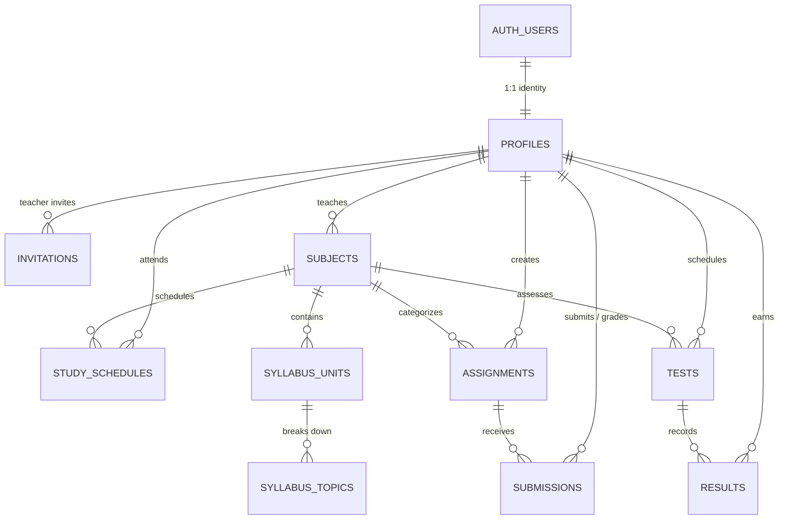

# StudyHub — Database Architecture & Schema Specification

This document details the PostgreSQL schema, relational entity models, constraints, indexes, and triggers engineered for the **StudyHub** Learning Management System.

---

## 1. Entity-Relationship Overview

---

## 2. Table Specifications

### 2.1 `public.profiles`
Primary identity extension for Supabase `auth.users`. Contains user demographic and academic details.

| Column | Type | Constraints | Description |
|---|---|---|---|
| `id` | `UUID` | `PRIMARY KEY`, `REFERENCES auth.users(id) ON DELETE CASCADE` | Matches Supabase Auth user ID |
| `full_name` | `TEXT` | `NOT NULL` | Display name of the user |
| `email` | `TEXT` | `NOT NULL`, `UNIQUE` | Institutional or personal email |
| `role` | `user_role` | `NOT NULL DEFAULT 'student'` | Enum: `'teacher'`, `'student'` |
| `avatar_url` | `TEXT` | `NULL` | Public or storage avatar URL |
| `phone` | `TEXT` | `NULL` | Contact telephone |
| `institution` | `TEXT` | `DEFAULT 'Department of Physical & Mathematical Sciences'` | Educational affiliation |
| `academic_class` | `TEXT` | `NULL` | e.g., "Grade 12", "Senior Year" |
| `course` | `TEXT` | `NULL` | e.g., "Advanced STEM Honors" |
| `board` | `TEXT` | `NULL` | e.g., "Cambridge International (CIE)" |
| `academic_session`| `TEXT` | `NULL` | e.g., "2026–2027" |
| `created_at` | `TIMESTAMPTZ`| `NOT NULL DEFAULT timezone('utc'::text, now())` | Creation timestamp |
| `updated_at` | `TIMESTAMPTZ`| `NOT NULL DEFAULT timezone('utc'::text, now())` | Auto-updated via trigger |

**Indexes**:
- `idx_profiles_role` on `profiles(role)`
- `idx_profiles_email` on `profiles(email)`

---

### 2.2 `public.invitations`
Teacher-managed tokenized invites enabling controlled student onboarding.

| Column | Type | Constraints | Description |
|---|---|---|---|
| `id` | `UUID` | `PRIMARY KEY DEFAULT gen_random_uuid()` | Unique invitation ID |
| `email` | `TEXT` | `NOT NULL` | Invitee's designated email |
| `role` | `user_role` | `NOT NULL DEFAULT 'student'` | Role to be granted upon signup |
| `token` | `TEXT` | `NOT NULL UNIQUE` | Cryptographic onboarding token |
| `academic_class` | `TEXT` | `NULL` | Target academic class |
| `course` | `TEXT` | `NULL` | Assigned curriculum / track |
| `board` | `TEXT` | `NULL` | Examination board |
| `academic_session`| `TEXT` | `NULL` | Academic year / session |
| `invited_by` | `UUID` | `NOT NULL REFERENCES profiles(id) ON DELETE CASCADE` | Faculty member who generated invite |
| `status` | `TEXT` | `NOT NULL DEFAULT 'pending'` | `'pending'`, `'accepted'`, `'expired'` |
| `expires_at` | `TIMESTAMPTZ`| `NOT NULL DEFAULT (now() + interval '7 days')` | Expiration window |
| `created_at` | `TIMESTAMPTZ`| `NOT NULL DEFAULT timezone('utc'::text, now())` | Creation timestamp |

**Indexes**:
- `idx_invitations_token` on `invitations(token)`
- `idx_invitations_email` on `invitations(email)`

---

### 2.3 `public.subjects`
Curriculum disciplines taught within the LMS.

| Column | Type | Constraints | Description |
|---|---|---|---|
| `id` | `TEXT` | `PRIMARY KEY` | Slug or identifier (e.g., `'sub_01'`) |
| `name` | `TEXT` | `NOT NULL` | Course title (e.g., "Advanced Calculus") |
| `code` | `TEXT` | `NOT NULL UNIQUE` | Course code (e.g., "MATH-301") |
| `teacher_id` | `UUID` | `NULL REFERENCES profiles(id) ON DELETE SET NULL` | Assigned lead instructor |
| `accent_color` | `TEXT` | `NOT NULL DEFAULT '#14B866'` | Brand color for badges & charts |
| `total_modules` | `INTEGER` | `NOT NULL DEFAULT 12` | Total modular units in curriculum |
| `next_class_time` | `TEXT` | `NULL` | Descriptive lecture slot |
| `schedule_days` | `TEXT[]` | `NOT NULL DEFAULT '{Mon,Wed,Fri}'` | Array of scheduled meeting days |
| `category` | `TEXT` | `NOT NULL DEFAULT 'STEM'` | `'STEM'`, `'Humanities'`, etc. |
| `created_at` | `TIMESTAMPTZ`| `NOT NULL DEFAULT timezone('utc'::text, now())` | Creation timestamp |
| `updated_at` | `TIMESTAMPTZ`| `NOT NULL DEFAULT timezone('utc'::text, now())` | Auto-updated via trigger |

---

### 2.4 `public.syllabus_units` & `public.syllabus_topics`
Hierarchical curriculum checkpoints.

#### `syllabus_units`
| Column | Type | Constraints | Description |
|---|---|---|---|
| `id` | `TEXT` | `PRIMARY KEY` | e.g. `'unit_01'` |
| `subject_id` | `TEXT` | `NOT NULL REFERENCES subjects(id) ON DELETE CASCADE` | Parent subject |
| `unit_number` | `INTEGER` | `NOT NULL` | Sequence number (1, 2, 3...) |
| `title` | `TEXT` | `NOT NULL` | Unit title |
| `description` | `TEXT` | `NULL` | Pedagogical summary |
| `created_at` | `TIMESTAMPTZ`| `NOT NULL DEFAULT timezone('utc'::text, now())` | Creation timestamp |

#### `syllabus_topics`
| Column | Type | Constraints | Description |
|---|---|---|---|
| `id` | `TEXT` | `PRIMARY KEY` | e.g. `'top_01'` |
| `unit_id` | `TEXT` | `NOT NULL REFERENCES syllabus_units(id) ON DELETE CASCADE` | Parent unit |
| `title` | `TEXT` | `NOT NULL` | Topic topic |
| `estimated_hours` | `NUMERIC(4,1)` | `NOT NULL DEFAULT 4.0` | Recommended study hours |
| `completed` | `BOOLEAN` | `NOT NULL DEFAULT false` | Student completion checkpoint |
| `notes_content` | `TEXT` | `NULL` | Formula sheet / conceptual notes |
| `sort_order` | `INTEGER` | `NOT NULL DEFAULT 0` | Ordering within unit |
| `created_at` | `TIMESTAMPTZ`| `NOT NULL DEFAULT timezone('utc'::text, now())` | Creation timestamp |

---

### 2.5 `public.assignments` & `public.submissions`
Homework assignments and student file submissions.

#### `assignments`
| Column | Type | Constraints | Description |
|---|---|---|---|
| `id` | `TEXT` | `PRIMARY KEY` | e.g. `'asg_01'` |
| `title` | `TEXT` | `NOT NULL` | Assignment title |
| `subject_id` | `TEXT` | `NOT NULL REFERENCES subjects(id) ON DELETE CASCADE` | Subject |
| `due_date` | `TEXT` | `NOT NULL` | Due date string or ISO date |
| `total_marks` | `INTEGER` | `NOT NULL DEFAULT 50` | Maximum points |
| `description` | `TEXT` | `NOT NULL` | Problem set briefing |
| `rubric_criteria` | `TEXT[]` | `NOT NULL DEFAULT '{}'` | Evaluation criteria points |
| `created_by` | `UUID` | `NULL REFERENCES profiles(id) ON DELETE SET NULL` | Authoring instructor |
| `created_at` | `TIMESTAMPTZ`| `NOT NULL DEFAULT timezone('utc'::text, now())` | Creation timestamp |
| `updated_at` | `TIMESTAMPTZ`| `NOT NULL DEFAULT timezone('utc'::text, now())` | Auto-updated via trigger |

#### `submissions`
| Column | Type | Constraints | Description |
|---|---|---|---|
| `id` | `UUID` | `PRIMARY KEY DEFAULT gen_random_uuid()` | Submission UUID |
| `assignment_id` | `TEXT` | `NOT NULL REFERENCES assignments(id) ON DELETE CASCADE` | Target assignment |
| `student_id` | `UUID` | `NOT NULL REFERENCES profiles(id) ON DELETE CASCADE` | Submitting student |
| `file_name` | `TEXT` | `NOT NULL` | Uploaded document filename |
| `file_url` | `TEXT` | `NOT NULL` | Path in private `student-submissions` bucket |
| `file_size` | `TEXT` | `NULL` | Human-readable size (e.g. "2.4 MB") |
| `comment` | `TEXT` | `NULL` | Student submission commentary |
| `status` | `submission_status` | `NOT NULL DEFAULT 'submitted'` | `'submitted'`, `'under-review'`, `'graded'` |
| `score` | `NUMERIC(5,2)` | `NULL` | Awarded marks |
| `feedback` | `TEXT` | `NULL` | Qualitative faculty evaluation |
| `graded_by` | `UUID` | `NULL REFERENCES profiles(id) ON DELETE SET NULL` | Evaluating teacher |
| `submitted_at` | `TIMESTAMPTZ`| `NOT NULL DEFAULT timezone('utc'::text, now())` | Submission timestamp |
| `graded_at` | `TIMESTAMPTZ`| `NULL` | Evaluation timestamp |

---

### 2.6 `public.tests` & `public.results`
Formal examinations, speed drills, and official gradebook entries.

#### `tests`
| Column | Type | Constraints | Description |
|---|---|---|---|
| `id` | `TEXT` | `PRIMARY KEY` | e.g. `'tst_01'` |
| `title` | `TEXT` | `NOT NULL` | Assessment title |
| `subject_id` | `TEXT` | `NOT NULL REFERENCES subjects(id) ON DELETE CASCADE` | Assessed subject |
| `date` | `DATE` | `NOT NULL` | Examination date |
| `time` | `TEXT` | `NOT NULL` | Time slot |
| `duration_minutes` | `INTEGER` | `NOT NULL DEFAULT 90` | Timed duration |
| `total_marks` | `INTEGER` | `NOT NULL DEFAULT 100` | Total marks |
| `type` | `TEXT` | `NOT NULL DEFAULT 'Unit Assessment'` | Exam format |
| `syllabus_coverage` | `TEXT` | `NOT NULL` | Syllabus topics tested |
| `status` | `test_status` | `NOT NULL DEFAULT 'scheduled'` | `'scheduled'`, `'in-progress'`, `'completed'`, `'graded'` |
| `created_by` | `UUID` | `NULL REFERENCES profiles(id) ON DELETE SET NULL` | Scheduling instructor |
| `created_at` | `TIMESTAMPTZ`| `NOT NULL DEFAULT timezone('utc'::text, now())` | Creation timestamp |

#### `results`
| Column | Type | Constraints | Description |
|---|---|---|---|
| `id` | `UUID` | `PRIMARY KEY DEFAULT gen_random_uuid()` | Result UUID |
| `test_id` | `TEXT` | `NOT NULL REFERENCES tests(id) ON DELETE CASCADE` | Associated test |
| `student_id` | `UUID` | `NOT NULL REFERENCES profiles(id) ON DELETE CASCADE` | Tested student |
| `score` | `NUMERIC(5,2)` | `NOT NULL` | Earned score |
| `max_score` | `NUMERIC(5,2)` | `NOT NULL DEFAULT 100` | Denominator score |
| `grade` | `TEXT` | `NOT NULL DEFAULT 'A*'` | Letter grade |
| `rank` | `TEXT` | `NULL` | Cohort standing |
| `feedback` | `TEXT` | `NULL` | Performance breakdown notes |
| `created_at` | `TIMESTAMPTZ`| `NOT NULL DEFAULT timezone('utc'::text, now())` | Recording timestamp |

---

## 3. Database Functions & Triggers

### 1. `public.handle_updated_at()`
Automatically synchronizes the `updated_at` column whenever a row in `profiles`, `subjects`, or `assignments` is modified.

### 2. `public.handle_new_user()`
Triggered upon every `INSERT` into `auth.users`. Automatically synchronizes metadata (e.g. `full_name`, `avatar_url`, and `role`) directly into `public.profiles`.

### 3. `public.get_auth_role()` (`SECURITY DEFINER`, `STABLE`)
Reads the calling user's current role directly from `public.profiles`. Designed specifically to prevent infinite recursion in RLS policies.

### 4. `public.is_teacher()` (`SECURITY DEFINER`, `STABLE`)
Helper evaluating to `TRUE` if `get_auth_role() = 'teacher'`.

### 5. `public.protect_role_escalation()`
Pre-update trigger on `public.profiles`. Blocks any user whose current role is not `'teacher'` from modifying their own or another user's `role` field.
